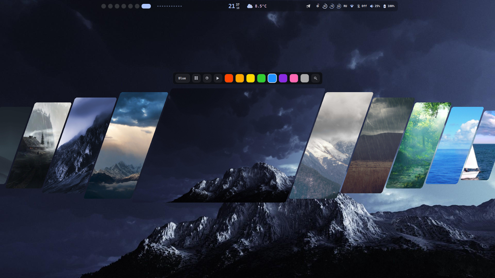
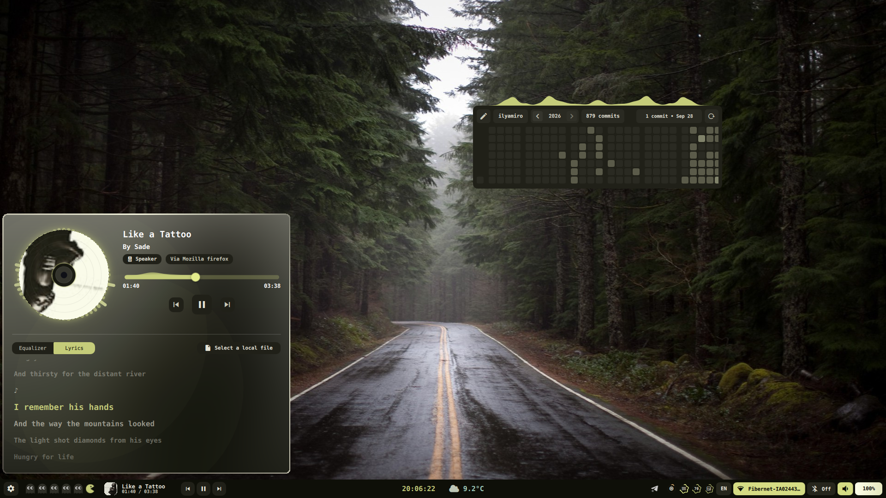
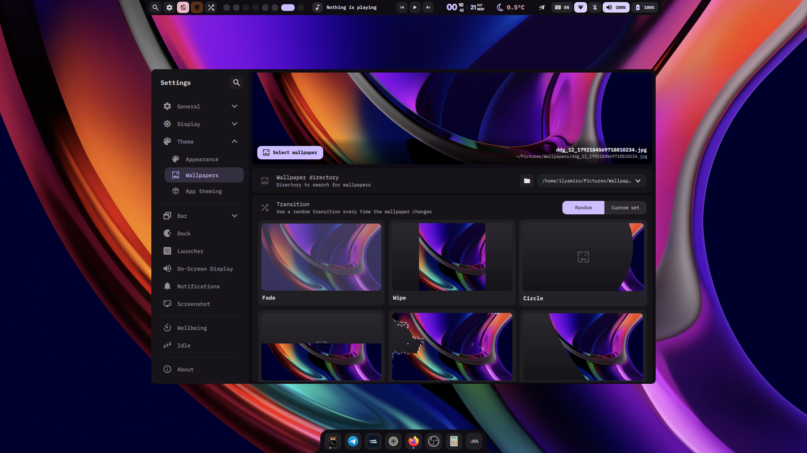
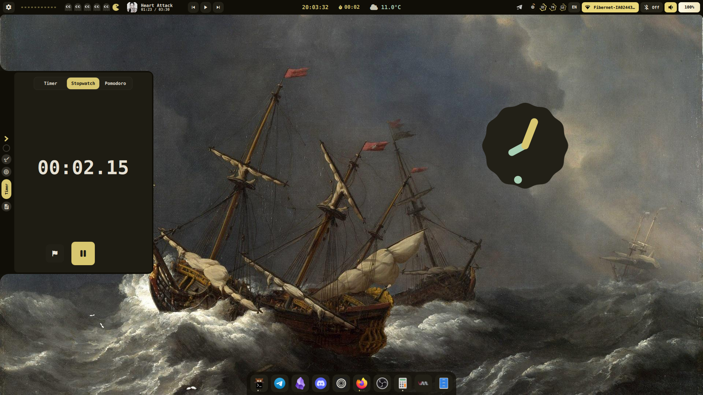

<div align="center">
  
</div>

## Previews

| | |
|---|---|
|  |  |
|  |  |

---

## Installation (Arch Linux only)

Taurus currently targets **Arch Linux and its derivatives** (CachyOS, EndeavourOS, Manjaro…), with systemd or OpenRC.

### Build the package from this repo (AUR packaging)

```bash
cd packaging/aur/taurus-git
makepkg -si
```

### One-line installer

```bash
curl -fsSL https://0x0ar.github.io/taurus/install.sh | bash
```

Or, from a clone of this repository: `bash install/install.sh`.

Docs: https://0x0ar.github.io/taurus/

To update, run the script again and choose "update".

---

## Companion programs

Taurus ships three small programs of its own, each in its own repository, built as release tarballs that the installer and the PKGBUILDs download:

- [taurus-core](https://github.com/0x0ar/taurus-core): background services over D-Bus (`org.taurus.Core`): system info, brightness, idle, clipboard, screen time.
- [taurus-gamma](https://github.com/0x0ar/taurus-gamma): the Wayland blue light filter (`org.taurus.Gamma`).
- [taurus-audio](https://github.com/0x0ar/taurus-audio): the PipeWire audio processor (equalizer, dynamics, visualizer).

They started as forks of serpantinum-core, -gamma and -audio (AGPL-3.0, by Illia Miroshnichenko). See [docs/components](docs/components).

---

## Supported compositors

Hyprland, Niri, Sway, Mango and Umbriel. The installer detects the running compositor and deploys its configuration.

---

## Running

To run the shell, launch `taurusd start`

For configuration, see [docs/configure/Configure.md](docs/configure/Configure.md).

---

## Origin and license

Taurus is made by **0x0ar**. It started as a fork of [Serpantinum](https://github.com/ilyamiro/serpantinum) (AGPL-3.0) and is being taken in its own direction. The original copyright notice is preserved, as the license requires.

Copyright (C) 2026 0x0ar

Portions Copyright (C) 2026 Illia Miroshnichenko (original Serpantinum)

This project is licensed under the GNU Affero General Public License version 3, or (at your option) any later version. See [LICENSE.md](LICENSE.md). If you offer a modified version to users over a network, the AGPL requires you to make its source available.
