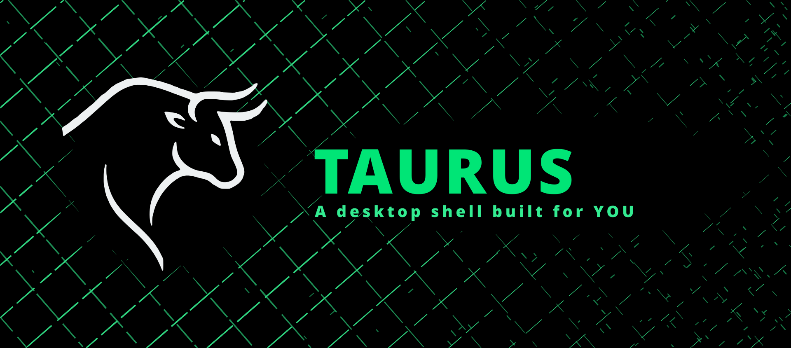

# Overview

**Taurus** is a Wayland desktop shell. Made by 0x0ar, focused on Arch Linux. It started as a fork of Serpantinum (AGPL-3.0, by ilyamiro).

## Compositor configuration

Taurus is only a desktop shell. It does not manage keybinds or monitors.

Compositor guides:

- [Hyprland](./configure/compositors/hyprland.md)
- [Niri](./configure/compositors/niri.md)
- [Sway](./configure/compositors/sway.md)
- [Mango](./configure/compositors/mango.md)
- [Umbriel](./configure/compositors/umbriel.md)

## App theming

Recolor GTK, Qt, terminals, editors and other apps with the shell palette: [App theming](./configure/AppTheming.md).

## AI agents

Taurus ships skills that teach AI coding agents to customize and troubleshoot your setup: [AI agents](./ai/agents.md).

## Installation

- [Arch Linux and derivatives](./installation/installation.md)

## Components

- [taurus-audio](./components/taurus-audio.md)
- [taurus-core](./components/taurus-core.md)
- [taurus-gamma](./components/taurus-gamma.md)
